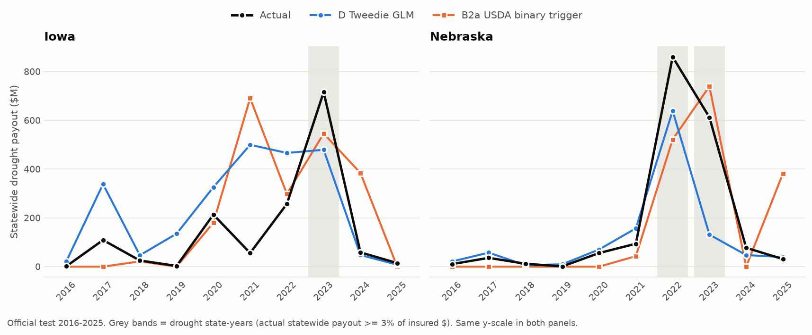

# Added after the official test. Same frozen predictions, presentation only. Nothing here was used to choose or change a model.

## 2b. Per state-year table: actual vs D, B2a, B2b, B1, B3 ($M; **bold** = closest to actual of the five shown)
| state | year | type | actual $M | D Tweedie GLM $M | B2a USDA binary trigger $M | B2b tiered LFP-style trigger $M | B1 drought-bin average $M | B3 liability only $M |
|---|---|---|---|---|---|---|---|---|
| IA | 2016 | quiet | 1.4 | 21.6 | **0.0** | 0.0 | 77.9 | 284.9 |
| IA | 2017 | quiet | 109.1 | 338.5 | 0.0 | 0.0 | **153.9** | 307.9 |
| IA | 2018 | quiet | 25.2 | 46.6 | **21.5** | 13.6 | 96.5 | 311.5 |
| IA | 2019 | quiet | 2.9 | 135.1 | **0.0** | 0.0 | 85.5 | 312.4 |
| IA | 2020 | quiet | 213.5 | 325.8 | **179.9** | 149.8 | 287.0 | 309.5 |
| IA | 2021 | quiet | 55.9 | 499.7 | 690.6 | 457.9 | 714.1 | **378.8** |
| IA | 2022 | quiet | 257.5 | 466.2 | **298.2** | 201.0 | 366.6 | 483.6 |
| IA | 2023 | drought | 716.0 | 479.2 | **545.8** | 342.5 | 902.7 | 492.5 |
| IA | 2024 | quiet | 58.5 | **47.8** | 384.1 | 371.5 | 504.0 | 402.0 |
| IA | 2025 | quiet | 14.6 | **7.8** | 0.0 | 0.0 | 110.6 | 404.5 |
| NE | 2016 | quiet | 10.5 | 21.3 | **0.0** | 0.0 | 26.3 | 164.4 |
| NE | 2017 | quiet | 36.1 | 57.4 | 0.0 | 0.0 | **41.2** | 178.6 |
| NE | 2018 | quiet | 11.7 | **5.9** | 0.0 | 0.0 | 25.6 | 182.1 |
| NE | 2019 | quiet | 1.1 | 9.7 | **0.0** | 0.0 | 19.7 | 184.8 |
| NE | 2020 | quiet | 55.8 | 70.4 | 0.0 | 0.0 | **61.2** | 185.1 |
| NE | 2021 | quiet | 94.0 | 157.0 | 43.0 | 52.5 | **93.5** | 227.3 |
| NE | 2022 | drought | 860.0 | **639.2** | 521.4 | 592.4 | 589.6 | 289.5 |
| NE | 2023 | drought | 612.5 | 131.5 | 739.3 | 1,225.0 | **732.5** | 291.5 |
| NE | 2024 | quiet | 77.3 | **47.4** | 0.0 | 0.0 | 113.3 | 236.5 |
| NE | 2025 | quiet | 30.9 | **39.4** | 382.2 | 270.2 | 369.9 | 241.1 |

## 2c. Scoreboard: how often D was closer to the actual statewide payout
Closer = smaller absolute statewide error in that state-year.

| comparison | all state-years (20) | drought state-years (3) | quiet state-years (17) |
|---|---|---|---|
| D closer to actual than B2a USDA binary trigger | 9 of 20 | 1 of 3 | 8 of 17 |
| D closer to actual than B2b tiered LFP-style trigger | 10 of 20 | 3 of 3 | 7 of 17 |
| D closer to actual than B1 drought-bin average | 11 of 20 | 1 of 3 | 10 of 17 |

## 2d. Chart: actual vs D vs B2a, statewide payout by year

*Extended presentation added from the saved outputs of the one official run (no model was re-run; see DECISIONS.md Entry 8). Per-row predictions in dollars, acres and Z: `test_predictions.csv`;
per state-year errors and D's scenario range: `test_state_years.csv`.*
