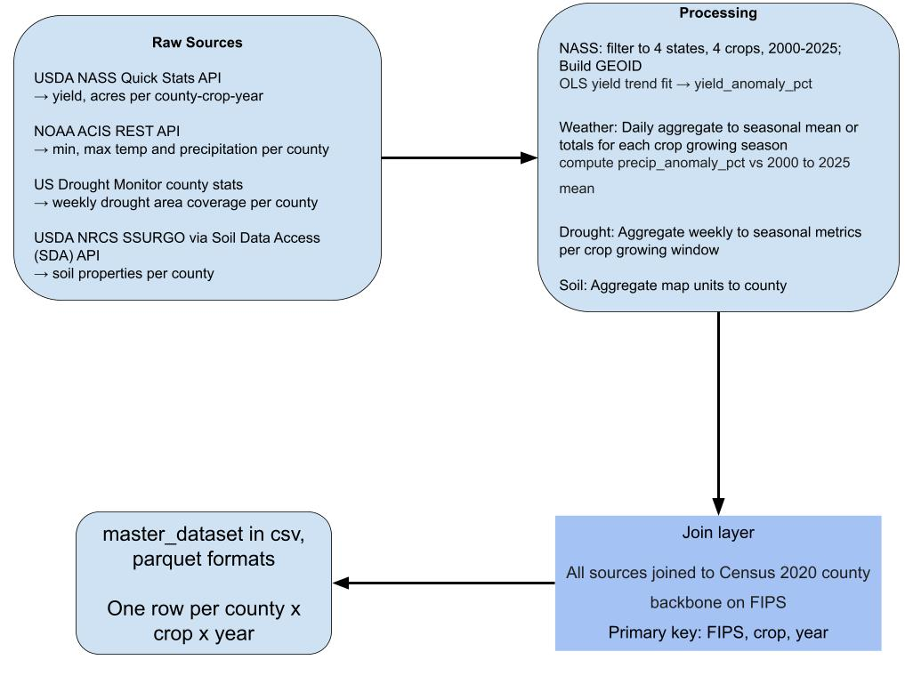

# HARVEST data guide

## Coverage and files

The supplied master has **17,056 rows, 21 columns, 230 counties and 11,639 reported yields**, spanning 2000–2025. One row is `(fips, crop, year)`. Boundary geometry contains 253 counties; 23 lack master records. States: CA, DE, IA, NE. Crops: corn grain, soybeans, winter wheat, grain sorghum.

| Data | Location / use |
|---|---|
| County/crop/year master | `data/master_dataset.parquet` or `.csv`; historical yield, weather, drought and soil. |
| Detailed schema | [Original data dictionary](../../data/data_dictionary.md); canonical field definitions, coverage and missingness. |
| Source panels | `data/processed/`: NASS yields/acres, ACIS daily weather, USDM weekly drought, static soil, optional irrigation/MODIS. |
| Geometry | `data/counties.geojson`; five-character county FIPS. |
| Insurance extension | `usda_budget_data/` and saved `app/model/artifacts/`; IA/NE corn/soybean insured exposure and decision-date features. |
| Drought experiments | `drought_severity_data/`; county-level outlook/in-season targets, separate from insurance and not connected to the website. |

Use `src.data_loader.load_master()` to normalize nullable integer columns, or pass `dtype={"fips": str}` when reading CSV. Analyze yields only where `yield_status == "reported"`. Suppressed, unreported and absent records are not zero yield/loss. IA/NE corn and soybeans have stronger coverage than CA/DE, wheat and sorghum; inspect the exact slice before making comparisons.

## Units and timing

| Field group | Meaning |
|---|---|
| Yield/acreage | Bushels per acre and planted/harvested acres. Planted uses include silage/grazing, so planted minus harvested is not simply abandonment. |
| Weather | Precipitation/soil water in mm, temperature in °C, heat-day counts and growing degree days. |
| Drought | Shifted master scale: 0 none, 1 D0, 2 D1, 3 D2, 4 D3, 5 D4. Weekly D0–D4 area percentages are categorical, not cumulative. DSCI is 0–500. |
| Soil | Available water in the top 100 cm; droughty county area percentage; NCCPI productivity 0–1. Soil repeats over years; sorghum uses the corn NCCPI proxy. |
| Insurance | Liability/full crop value/payouts in USD; insured/damaged acres; coverage and predicted shares as fractions. |

Full-season windows: corn May–September; soybeans May–October; sorghum June–October; winter wheat September of the previous year through June of the harvest year. Wheat 2000 drought coverage is incomplete because USDM starts in January 2000.

Decision-time insurance features instead use weather/maps available by August 15 (weekly map date through August 13). Do not substitute the master's full-season weather, harvested acres, annual MODIS or all-years anomalies into that model. History/Planner use hindsight yield trends; they are not held-out forecasts. Irrigation coverage is incomplete, MODIS includes non-crop land and annual greenness, and soil storage is not irrigation applied.

## Rebuilding

Normal app use reads included files. For an intentional rebuild, inspect `src/build/` and run NASS, USDM, ACIS and SSURGO pulls, then `validate_sources.py` and `build_master.py`. NASS needs `NASS_API_KEY` in ignored `.env`; optional MODIS rebuilding needs Earth Engine configuration. RMA preparation uses `organize_usda_data.py`; its cutoff rules and saved feature order are part of the [prediction contract](../engineering/predictions.md).

This diagram describes source-data preparation, not the HARVEST page/model request flow.

## Sources and credits

- **U.S. Drought Monitor:** jointly produced by the National Drought Mitigation Center at the University of Nebraska–Lincoln, USDA and NOAA. [Source](https://droughtmonitor.unl.edu/).
- **USDA NASS:** yield/acreage and irrigation via [Quick Stats](https://quickstats.nass.usda.gov/api). This product uses the NASS API but is not endorsed or certified by NASS.
- **USDA RMA:** historical crop-insurance exposure and cause-of-loss outcomes; insurance payments are not total crop-value loss or state relief spending.
- **NOAA ACIS:** daily weather from the Applied Climate Information System and NOAA Regional Climate Centers. [API documentation](https://docs.rcc-acis.org/acisws/).
- **Soil:** Soil Survey Staff, NRCS, USDA; Soil Survey Geographic Database (SSURGO), via [Soil Data Access](https://sdmdataaccess.nrcs.usda.gov/).
- **MODIS:** Didan, K. (2021), MODIS/Terra Vegetation Indices 16-Day L3 Global 250m SIN Grid V061, NASA EOSDIS LP DAAC. [DOI](https://doi.org/10.5067/MODIS/MOD13Q1.061).
- **Boundaries:** U.S. Census county geometry supplied through [plotly/datasets](https://github.com/plotly/datasets).
- **Retained imagery helper:** USGS National Map tiles, credited when used. The active Insurance map uses local extruded geometry, not satellite tiles.
